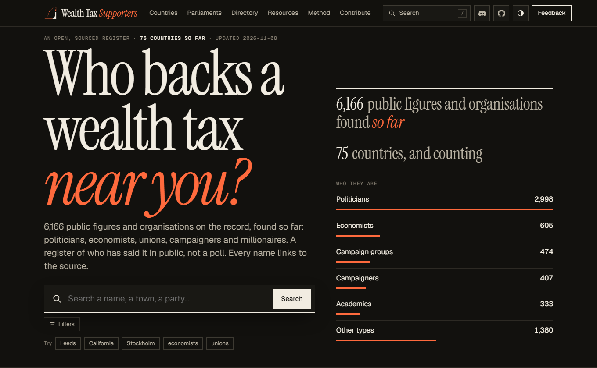
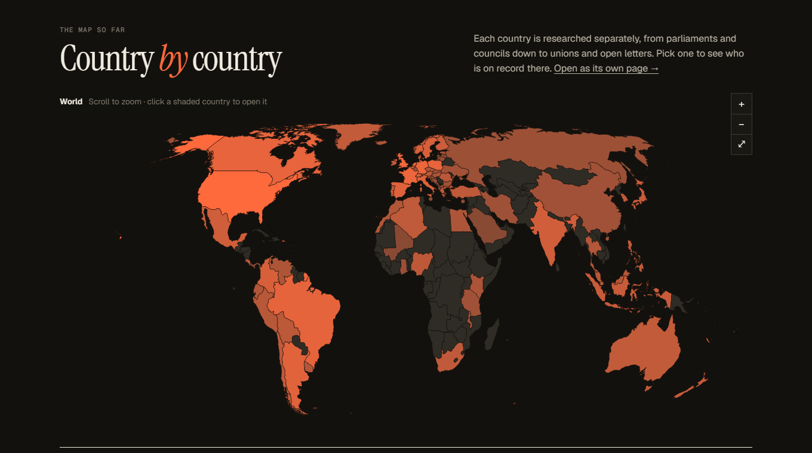
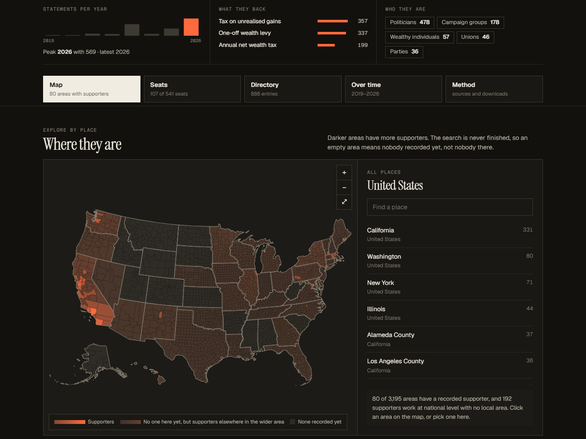
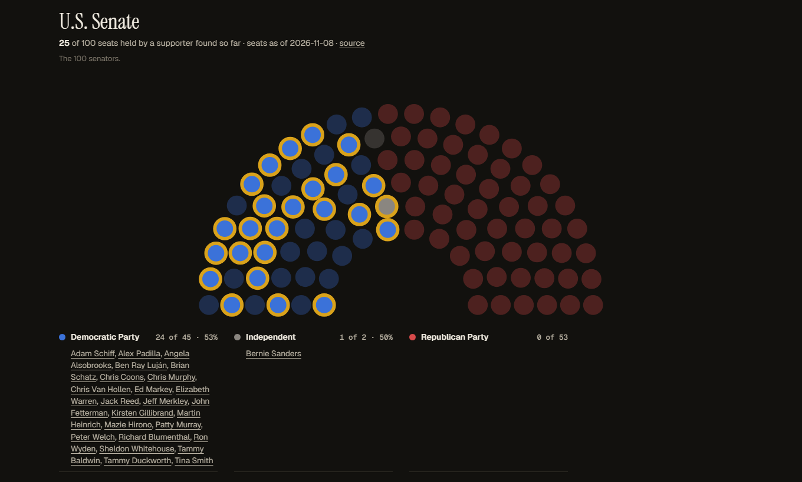
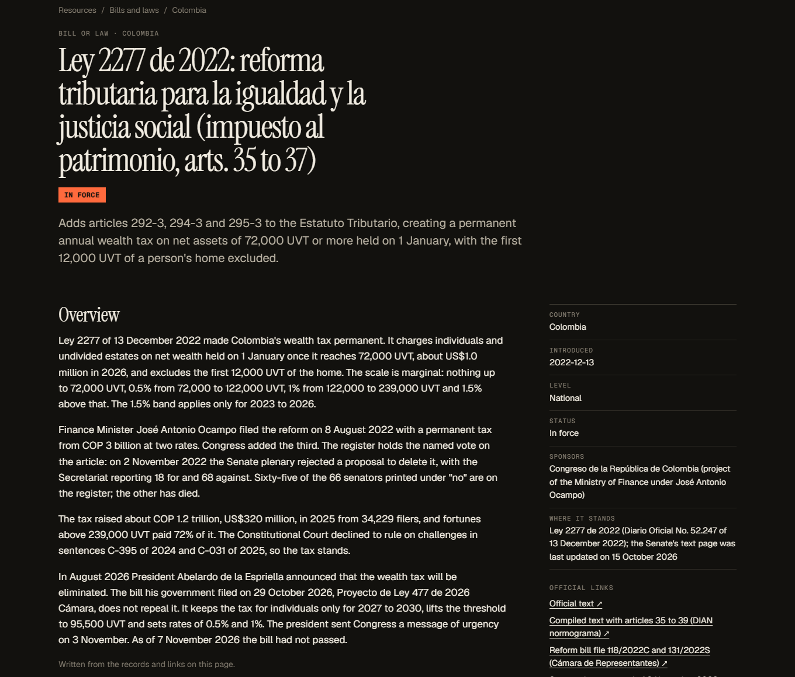
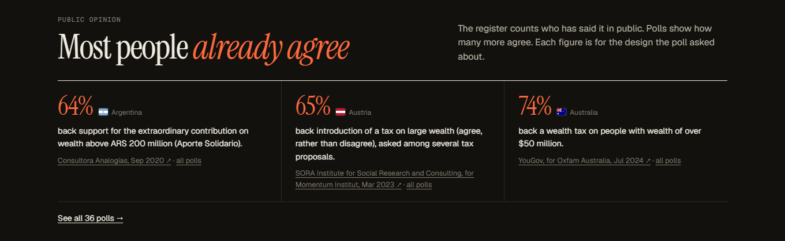

<div align="center">

# Wealth Tax Supporters

**Who backs a wealth tax near you?**

An open, sourced register of the politicians, economists, unions, campaigners and millionaires who have said in public that wealth should be taxed. Over 6,000 names in 75 countries. Every one links to its source.

[**wealthtaxsupporters.com**](https://wealthtaxsupporters.com) · [Join the Discord](https://discord.gg/yCjEK47aeh) · [Report a mistake](../../issues/new?template=data-report.yml) · [Add your country](docs/developing.md#add-your-country)

<a href="https://wealthtaxsupporters.com"></a>

</div>

## What this is

Polls say most people agree that the very rich should pay a wealth tax, yet it is hard to find out who is actually saying so, and where. This project collects that public record: who proposed a bill, signed a motion, voted for it, or said it in a speech, an interview or an open letter. Each entry carries a date, a link and a short quote taken from the page.

It is a register of people who have said it in public, not a poll and not a petition. Nobody is added because of a guess. Opponents are not listed, and private individuals never are.

## A look around

### Start with the world, then go local

Search a name, a town or a party, or click a country. Each country goes down to its lowest tier of local government where open boundary data exists, so you can see which counties, municipalities or districts have a public supporter.





### See who sits in your parliament

Each chamber is drawn as one dot per seat. A lit dot is a sitting member whose support is on the record. An unlit dot means nothing found yet, never that the member is against it.



### Read the bills, not just the headlines

Every bill and law on the Resources page has its own page: what it proposes, where it stands, the official documents, and every vote, sponsorship and speech in the register that comes from it. Colombia's wealth tax, for example, carries 65 named votes from the Senate record.



### Public opinion in one place

Poll results sit next to the register, each with its pollster, date and the exact design it asked about.



There are also country stories that make the case in one read (start with [Colombia](https://wealthtaxsupporters.com/co)), a directory you can filter by place and type, and a timeline of statements per year.

## What counts

- **An actual wealth tax:** a recurring tax on net wealth, a one-off levy, or a minimum tax on billionaires. Income, inheritance, property and capital-gains reforms alone do not count.
- **Evidence for every entry:** a dated, linked source and a short quote that is on the page. Grades say how strong it is: **A** a formal act or a stated design (a bill, a motion signature, a vote on the tax itself, the person's own proposal), **B** named by a roster or a journalist, **C** an option or weak wording.
- **Public figures and organisations only.** Petition signers and private individuals are never recorded.
- **Seats** are lit only for someone found on the chamber's official list today.

The full rules are in [`skill/references/definition-and-grades.md`](skill/references/definition-and-grades.md).

> **Heads up: the data is AI-generated and may be wrong.** The register is built with AI research assistants, and many rows have not yet been checked by a person. Every entry links to its source so you can check it yourself. If you spot a mistake or want an entry removed, use the **Report** link on the site or [open an issue](../../issues/new?template=data-report.yml).

## How it is built

Each country is a folder of plain CSV files under [`data/`](data), one row per person, statement, source and seat. A small Python script turns those files into a static site with no framework, served from Cloudflare. A research skill in [`skill/`](skill) tells people and AI assistants how to search: start broad in every official language, work through each layer (legislature, parties, unions, economists, commentators), follow the leads, and read the official record in full, since a bill's votes and speeches are often spread across dozens of documents. Coverage is reported honestly: a blank means not searched.

## Help out

- **Spot an error or a missing supporter:** use the Report link on any page, or [open an issue](../../issues/new/choose).
- **Add a country, or deepen one:** the open work is on the [roadmap board](https://github.com/users/Egalitaristen/projects/3) and in issues labelled [`records`](../../issues?q=is%3Aissue+is%3Aopen+label%3Arecords) (read a country's official record and write its bill pages) and [`roadmap`](../../issues?q=is%3Aissue+is%3Aopen+label%3Aroadmap). The step-by-step guide is in [docs/developing.md](docs/developing.md) and [CONTRIBUTING.md](CONTRIBUTING.md).
- **Talk to us:** the [Discord](https://discord.gg/yCjEK47aeh).

To run the site locally:

```bash
pip install pycountry pillow
python scripts/build_site.py      # writes _site/
python scripts/serve.py           # http://localhost:8000
```

More on the layout, scripts and deploys is in [docs/developing.md](docs/developing.md). A community layer for ordinary supporters is planned but not built ([docs/community.md](docs/community.md)).

## Licences

- Code: [MIT](LICENSE).
- Data in `data/`: [CC BY 4.0](DATA_LICENSE.md). Quotes are short extracts from cited sources and stay under their owners' copyright.
